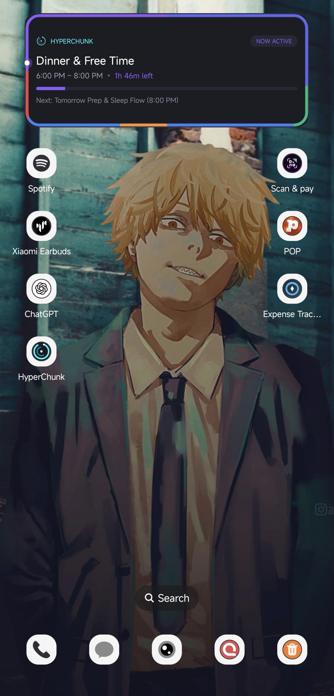
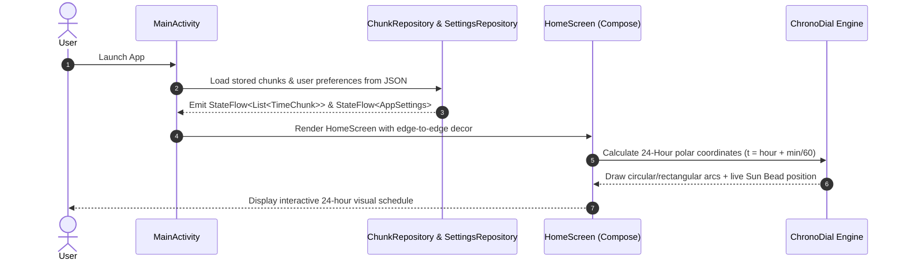
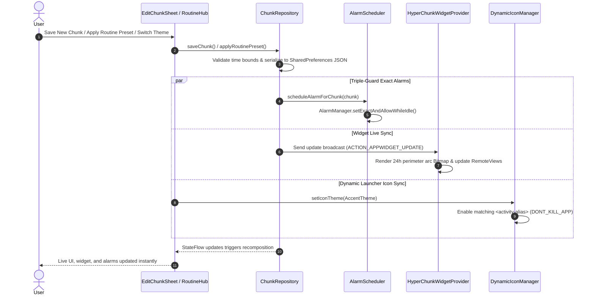

<div align="center">

# ⏱️ HyperChunk
### (currently optimised for hyper os 3)
### The 24-Hour Polar Visual Time Planner for Android & Xiaomi HyperOS

[](https://kotlinlang.org)
[](https://developer.android.com/jetpack/compose)
[](https://m3.material.io)
[](https://developer.android.com)
[](https://github.com)

<p align="center">
  <b>Forget messy calendars and overwhelming to-do lists.</b><br>
  HyperChunk turns your entire 24-hour day into a circular visual chronograph dial. Every minute is mapped into color-coded focus blocks with real-time tracking, hardened alarms, and a native homescreen widget.
</p>

---


*The 4x2 HyperOS Homescreen Widget: Dynamic 24-hour perimeter glow ring, real-time sun bead, countdown timer, and upcoming task preview.*

</div>

---

## 💡 Why HyperChunk?

Traditional calendar and planner apps suffer from two major problems:
1. **Endless Vertical Lists**: Looking at a flat list or standard calendar doesn't give you an intuitive sense of how much day is actually left or how your time is divided.
2. **Setup Friction**: Creating simple routines takes too many clicks, date pickers, and unwanted notifications.

**HyperChunk solves this with Polar Time Planning:**
- Your entire day is mapped onto a **24-hour continuous circle** (like a watch face for the full day).
- A glowing **Sun Bead** tracks your real-time position on the dial.
- You instantly spot your sleep cycles, study blocks, deep work sprints, and hidden free time.

---

## ✨ Everything You Can Do With HyperChunk

### 1. Dual Chronograph Dial Modes

Choose how you want to visualize your 24 hours. Both modes render real-time color arcs for every chunk and track the live sun bead.

<table align="center">
  <tr>
    <td align="center" width="50%">
      <b>24-Hour Circular Dial</b><br>
      <i>Classic polar watchface with 12 AM / 6 AM / 12 PM / 6 PM cardinal markers and centered digital time.</i><br><br>
      
    </td>
    <td align="center" width="50%">
      <b>24-Hour Rectangle Chrono</b><br>
      <i>Widescreen card layout stretching the 24-hour perimeter smoothly around rounded card edges.</i><br><br>
      
    </td>
  </tr>
</table>

- **Live Sun Bead**: An illuminated orbital indicator circles the dial in real-time, showing your current position in the day down to the minute.
- **Centered Clean Readout**: Clear digital clock display centered within the dial without visual clutter.
- **Instant Chunk Arcs**: Chunks are drawn proportionally (1 hour = 15 degrees) using category accent colors.

---

### 2. Daily Timeline & Free Slot Gap Filling

<table align="center">
  <tr>
    <td align="center" width="50%">
      <b>Timeline Blocks with Active Glow</b><br>
      <i>Organized schedule cards with category color bars, duration readouts, and individual alarm toggles.</i><br><br>
      
    </td>
    <td align="center" width="50%">
      <b>Smart Gap Detection</b><br>
      <i>Instant analytics bar shows active vs. free hours. Tap "⚡ Fill Free Slots" to turn idle gaps into structured time.</i><br><br>
      
    </td>
  </tr>
</table>

- **Day Breakdown Bar**: Color-segmented progress bar calculating your total active hours vs remaining free hours across Monday to Sunday.
- **Live `• NOW` Indicator**: Highlights the currently active chunk with a glowing accent border and real-time remaining countdown.
- **⚡ Fill Free Slots**: One tap automatically scans your day for unscheduled gaps and offers to schedule them as productive focus or recovery blocks.
- **Interactive Drum Wheel Picker**: Set start and end times with smooth vertical scrolling, inertial physics, and tactile haptic clicks.
- **Quick Duration Buttons**: Jump between +30m, 1h, 2h, and 3h durations with a single tap.

---

### 3. Modular Routine Studio & Schedule Replication

Save hours of manual scheduling with curated archetypes and cross-day synchronization.

<table align="center">
  <tr>
    <td align="center" width="50%">
      <b>Modular Routine Studio</b><br>
      <i>Curated archetypes and the Schedule Replication Matrix.</i><br><br>
      
    </td>
    <td align="left" width="50%">
      <h3>Ready-to-Use Archetypes</h3>
      <ul>
        <li><b>⚖️ The 8-8-8 Rule</b>: Balanced distribution of 8h Sleep, 8h Deep Focus/Work, and 8h Life &amp; Rest.</li>
        <li><b>🎓 Student / College Grind</b>: Morning lecture slots, structured afternoon revisions, and evening gym sessions.</li>
        <li><b>⚡ Deep Work &amp; Maker Sprint</b>: Unbroken creative flow blocks with minimal interruptions.</li>
      </ul>
      <hr>
      <h3>Schedule Replication Matrix</h3>
      <ul>
        <li>Copy your perfect Monday routine to all <b>Weekdays</b>, <b>Weekends</b>, or the <b>Entire Week</b> with one tap.</li>
        <li>Choose between <b>Overwrite Target</b> or <b>Smart Merge</b> (preserving your existing chunks).</li>
      </ul>
    </td>
  </tr>
</table>

---

### 4. Deep Personalization & AMOLED Dark Mode

Make HyperChunk look and feel native to your personal workflow and setup.

<table align="center">
  <tr>
    <td align="center" width="50%">
      <b>Theme Palettes &amp; Text Scaling</b><br>
      <i>Vibrant multi-color or stealth monochrome palettes with real-time live preview.</i><br><br>
      
    </td>
    <td align="center" width="50%">
      <b>Haptic Engine &amp; Dial Shapes</b><br>
      <i>Custom haptic feedback intensities, 12h/24h formats, and pure black AMOLED backgrounds.</i><br><br>
      
    </td>
  </tr>
</table>

- **Palette Modes**: Switch between **Colourful** (rich distinct category tones) and **Monochrome** (pure minimalist grayscale).
- **6 Accent Color Schemes**: Synchronize the entire app UI with **Cyber Cyan**, **Pixel Blue**, **Electric Lime**, **Amethyst Violet**, **Sunset Amber**, or **Rose Crimson**.
- **OLED Pure Black**: 100% `#000000` deep black canvas for maximum power savings on OLED/AMOLED displays.
- **Custom Haptic Engine**: Choose your tactile feel: `Off`, `Light`, `Smooth`, or `Ratchet` mechanical clicks.
- **Screen Optimization Mode**: Automatically adapts dial dimensions and card padding for compact and tall screens.

---

### 5. Homescreen Widget & Dynamic Launcher App Icons

HyperChunk keeps you oriented even when the app is closed.

<table align="center">
  <tr>
    <td align="center" width="60%">
      <b>HyperOS 3 Homescreen Widget</b><br>
      <i>Glance widget with 24h perimeter ring, active task timer, and upcoming event preview.</i><br><br>
      
    </td>
    <td align="center" width="40%">
      <b>Color-Synced Dynamic App Icon</b><br>
      <i>The app icon dynamically matches your selected accent color.</i><br><br>
      <br><br>
      <small><i>Shown in Cyber Cyan theme</i></small>
    </td>
  </tr>
</table>

- **24-Hour Edge Ring**: The widget draws your entire day around its outer border, complete with real-time glowing sun bead position.
- **Dynamic `<activity-alias>` Icons**: When you change your theme in Settings, HyperChunk switches the launcher icon to match your chosen accent color without killing the app.
- **Triple-Guard Alarms**: Reliable notifications powered by `AlarmManager.setExactAndAllowWhileIdle()` so you never miss a study block or wake-up call, even in aggressive battery-saving modes.

<details>
<summary><b>📱 View Full Android Homescreen Setup</b></summary>
<br>
<div align="center">
  
</div>
</details>

---

## 🛠️ Architecture & Tech Stack

HyperChunk is engineered with modern Android architecture principles:

- **100% Native Kotlin**: Fully compiled with Kotlin 2.0 and JVM 17.
- **Jetpack Compose + Material 3**: Declarative UI built with custom HyperOS squircle geometry and smooth animated states.
- **Reactive State Flow**: Unidirectional Data Flow (UDF) powered by Kotlin `StateFlow` and Compose `collectAsStateWithLifecycle()`.
- **Canvas Math & Polar Geometry**: High-performance trigonometric rendering (`cos`, `sin`, `arcTo`) running on hardware-accelerated canvas.
- **100% Local & Private**: All data is stored on-device in encrypted SharedPreferences via GSON JSON serialization. No cloud servers, no account registration, no telemetry, and zero tracking.

---

## 📂 Codebase Directory Structure

```
app/src/main/java/com/hyperchunk/app/
│
├── MainActivity.kt                      # Single Activity host with edge-to-edge Compose container
│
├── alarm/                               # Triple-Guard Alarm & Notification Subsystem
│   ├── AlarmReceiver.kt                 # BroadcastReceiver triggered on chunk start
│   ├── AlarmScheduler.kt                # Schedules exact alarms with setExactAndAllowWhileIdle()
│   ├── BootReceiver.kt                  # Restores alarms on device reboot (RECEIVE_BOOT_COMPLETED)
│   └── NotificationHelper.kt            # High-priority notification channels, sounds, and vibration
│
├── data/                                # Data Models, Repositories, & Storage
│   ├── model/
│   │   ├── AppSettings.kt               # App configuration (theme, accent, dial shape, haptics)
│   │   └── TimeChunk.kt                 # Core model: start/end minutes, category, title, alarm state
│   └── storage/
│       ├── ChunkRepository.kt           # Day-by-day JSON persistence, gap-filling, routine cloning
│       ├── DynamicIconManager.kt        # Android activity-alias switcher for dynamic app icons
│       └── SettingsRepository.kt        # SharedPreferences-backed reactive settings manager
│
├── ui/                                  # Jetpack Compose UI Layer
│   ├── components/
│   │   ├── Chunk24hChronograph.kt       # 24-Hour Circular Dial with color arcs & live sun bead
│   │   ├── Chunk24hRectangleChronograph.kt # Widescreen Rectangular Chrono Dial
│   │   ├── Chunk24hBar.kt               # Segmented daily breakdown progress & active stats bar
│   │   ├── ChunkCard.kt                 # Timeline block card with category bar & alarm toggle
│   │   ├── DaySelector.kt               # Mon to Sun horizontal day-of-week navigation pill
│   │   ├── HyperCard.kt                 # HyperOS 3 frosted squircle container component
│   │   ├── RoutineHubSheet.kt           # Archetype routines & schedule replication bottom sheet
│   │   ├── SettingsSheet.kt             # Appearance, palette, font scaling, & haptics bottom sheet
│   │   ├── WheelTimePicker.kt           # Interactive vertical drum wheel time picker with snapping
│   │   ├── RatchetFeedbackManager.kt    # Mechanical stepped click haptic feedback
│   │   └── SmoothFeedbackManager.kt     # Fluid analog haptic feedback
│   │
│   ├── screens/
│   │   ├── HomeScreen.kt                # Root screen scaffold coordinating dial, stats, & timeline
│   │   └── EditChunkSheet.kt            # Bottom sheet for creating and modifying time chunks
│   │
│   └── theme/
│       ├── Color.kt                     # Cyber Cyan, Pixel Blue, Lime, Amethyst, Amber, Crimson palettes
│       └── HyperTheme.kt                # Dynamic Material 3 dark/AMOLED theme provider
│
└── widget/                              # Android Homescreen Widget
    └── HyperChunkWidgetProvider.kt      # 4x2 Glance widget with Canvas-rendered 24h perimeter ring
```

---

## 🔄 End-to-End Code Execution & Data Flow

### 1. Application Launch & UI Initialization



### 2. Chunk Modification, Alarm Scheduling & Widget Synchronization



---

## 🚀 Building & Installation

### Prerequisites
- Android SDK 35 (`compileSdk = 35`, `minSdk = 26`)
- Java Development Kit (JDK) 17
- Gradle 8.9 (included via project wrapper)

### Build Debug APK
```bash
./gradlew assembleDebug
```
The compiled APK will be located at:
`app/build/outputs/apk/debug/app-debug.apk`

### Build Optimized Release APK
```bash
./gradlew assembleRelease
```
The release APK will be located at:
`app/build/outputs/apk/release/app-release-unsigned.apk`

### Run Unit Tests
```bash
./gradlew test
```
All unit tests in `StressTest.kt` and `TimeChunkTest.kt` validate 24-hour boundary wrapping, schedule duplication, and gap detection algorithms.

### Install via ADB
```bash
adb install -r app/build/outputs/apk/debug/app-debug.apk
```

---

## 🔒 Privacy & Permissions

- **100% Offline**: Requires zero network or internet permissions.
- **Zero Tracking**: No Google Analytics, Firebase, or external SDKs.
- **Battery Friendly**: Uses exact alarms only for scheduled events; zero background battery drain.
- **Required Permissions**:
  - `POST_NOTIFICATIONS`: For chunk reminder notifications (Android 13+).
  - `SCHEDULE_EXACT_ALARM`: For punctual start alarms.
  - `RECEIVE_BOOT_COMPLETED`: To restore active alarms after phone restart.
  - `VIBRATE`: For tactile haptic clicks and alarm buzzes.

---

## 📄 License

This project is licensed under the MIT License. See [LICENSE](LICENSE) for details.
