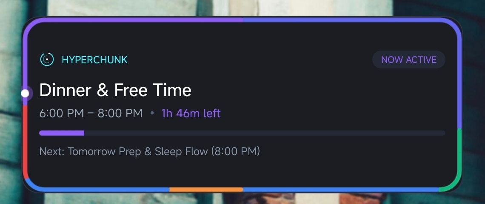
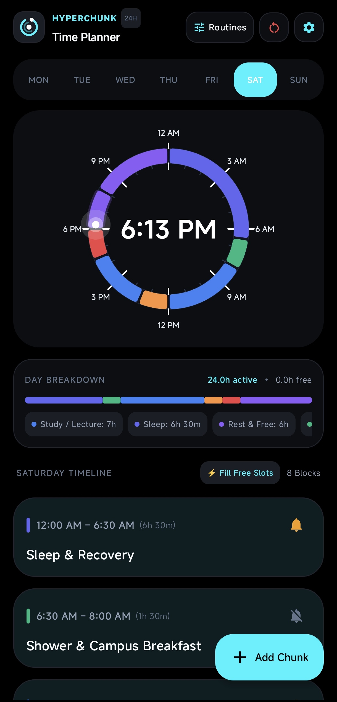
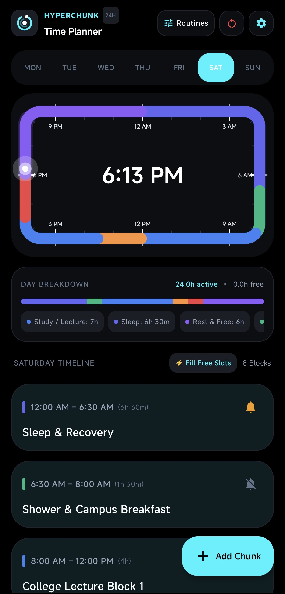
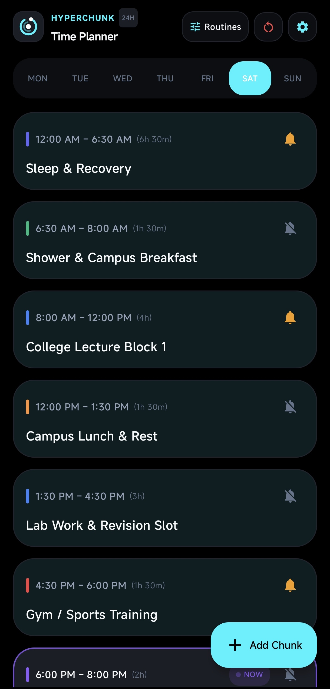
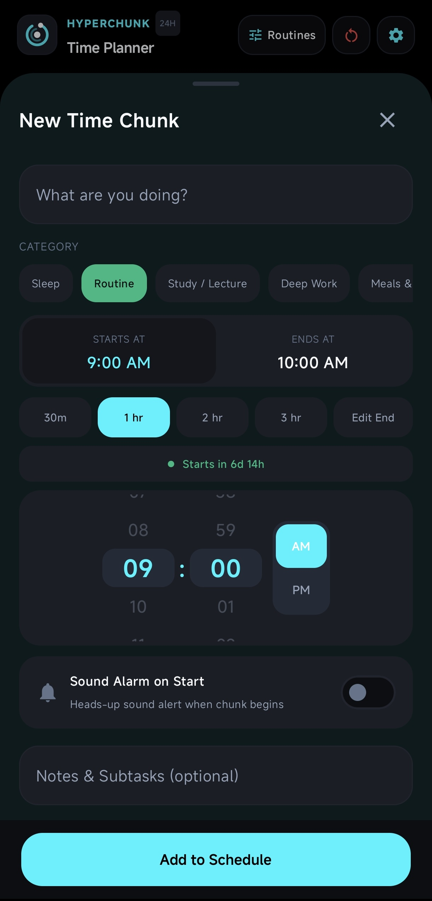
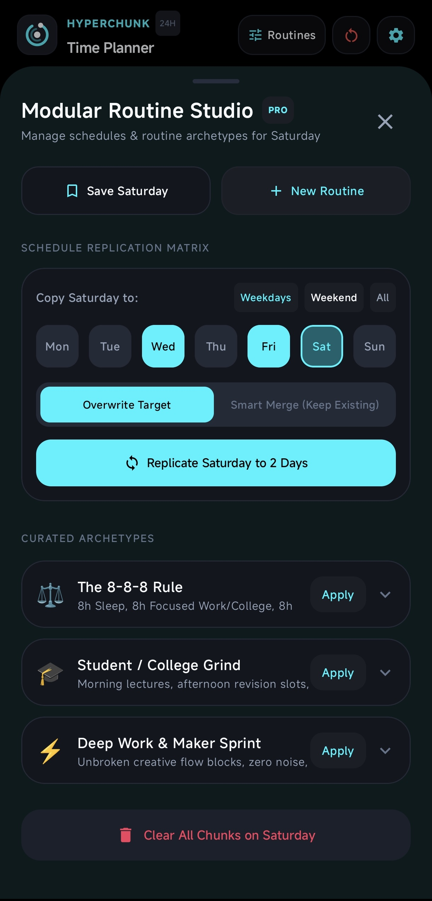
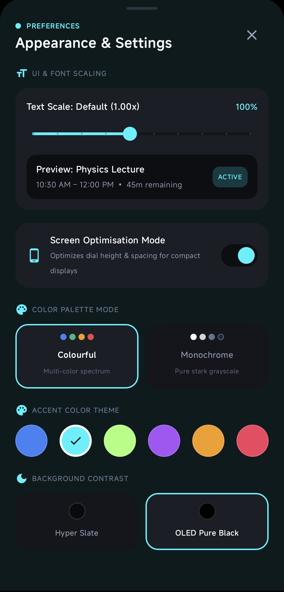
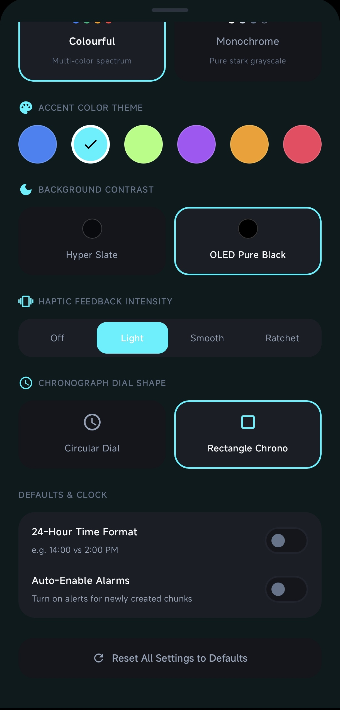
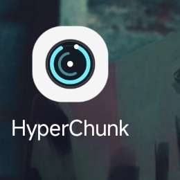
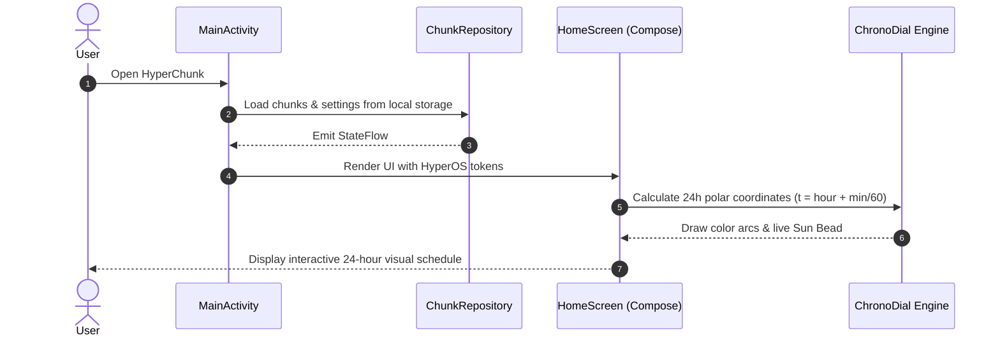

<div align="center">

# ⏱️ HyperChunk
### (currently optimised for hyper os 3)
**A clean, 24-hour visual time planner for Android & Xiaomi HyperOS**

[](https://kotlinlang.org)
[](https://developer.android.com/jetpack/compose)
[](https://m3.material.io)
[](https://developer.android.com)
[](https://github.com)

<p align="center">
  Most planners give you endless to-do lists that feel like chores.<br>
  <b>HyperChunk maps your entire 24-hour day onto a single clock dial.</b><br>
  See your sleep, study, deep work, and free time in one quick glance.
</p>



<p align="center"><i>Live 4x2 Homescreen Widget: 24-hour perimeter glow ring, real-time sun bead, countdown timer, and next task preview.</i></p>

</div>

## 💡 What Makes HyperChunk Different?

Standard calendar apps make you tap through dates, invites, and notifications just to set up a daily routine.

HyperChunk keeps it visual and simple:
• **Your Whole Day on a Clock**: See all 24 hours at once. No scrolling back and forth between hours.
• **Real-Time Sun Bead**: A glowing dot circles the dial with the real time. You always know where you are in your day.
• **Spot Free Time Instantly**: Instantly see where you have empty slots so you can study, hit the gym, or relax.

## ✨ Features

### 1. Two Clock Styles (Circle & Rectangle)

Choose between a classic circular watch dial or a widescreen rectangular chrono.

<table align="center" width="100%">
  <tr>
    <th align="center" width="50%">Circular Dial</th>
    <th align="center" width="50%">Rectangle Chrono</th>
  </tr>
  <tr>
    <td align="center" valign="top">
      
    </td>
    <td align="center" valign="top">
      
    </td>
  </tr>
</table>

• **24-Hour Layout**: 12 AM at the top, 12 PM at the bottom.
• **Live Sun Indicator**: Tracks your exact minute of the day.
• **Clean Centered Clock**: Big, readable digital clock in the center.

### 2. Daily Timeline & One-Tap Free Slot Filling

<table align="center" width="100%">
  <tr>
    <th align="center" width="50%">Timeline Schedule</th>
    <th align="center" width="50%">Add or Edit Chunks</th>
  </tr>
  <tr>
    <td align="center" valign="top">
      
    </td>
    <td align="center" valign="top">
      
    </td>
  </tr>
</table>

• **Day Breakdown Bar**: Shows your total active hours vs remaining free hours across Monday to Sunday.
• **Live NOW Badge**: Highlights whatever task is happening right now with a countdown timer.
• **⚡ Fill Free Slots**: Tap one button to automatically find unscheduled gaps and turn them into focus or rest blocks.
• **Smooth Drum Wheel**: Spin the hour and minute wheels with realistic haptic clicks.
• **Quick Duration Buttons**: Add +30m, 1h, 2h, or 3h with a single tap.

### 3. Routine Studio (Templates & 1-Tap Week Copy)

<table align="center" width="100%">
  <tr>
    <th align="center" width="50%">Routine Studio</th>
    <th align="center" width="50%">Preset Routines</th>
  </tr>
  <tr>
    <td align="center" valign="top">
      
    </td>
    <td align="left" valign="top">
      <br>
      <b>Ready-to-Use Templates:</b>
      <ul>
        <li><b>The 8-8-8 Rule</b>: 8h Sleep, 8h Work/College, 8h Personal Life.</li>
        <li><b>Student Grind</b>: Morning lectures, afternoon revisions, evening gym.</li>
        <li><b>Deep Work</b>: Long, unbroken focus blocks for projects and coding.</li>
      </ul>
      <br>
      <b>Schedule Replication:</b>
      <ul>
        <li>Set up Monday once, then tap to replicate it across all <b>Weekdays</b> or <b>Weekends</b>.</li>
        <li>Choose to overwrite or smart-merge with existing tasks.</li>
      </ul>
    </td>
  </tr>
</table>

### 4. Custom Themes, AMOLED Black & Dynamic App Icons

<table align="center" width="100%">
  <tr>
    <th align="center" width="33%">Theme Settings</th>
    <th align="center" width="33%">Haptic Feedback</th>
    <th align="center" width="33%">Homescreen & App Icon</th>
  </tr>
  <tr>
    <td align="center" valign="top">
      
    </td>
    <td align="center" valign="top">
      
    </td>
    <td align="center" valign="top">
      
      <br><br>
      
    </td>
  </tr>
</table>

• **6 Accent Colors**: Cyber Cyan, Pixel Blue, Electric Lime, Amethyst Violet, Sunset Amber, and Rose Crimson.
• **Color-Synced App Icon**: The launcher icon on your phone automatically switches its color ring to match your chosen theme.
• **OLED Pure Black**: 100% black background for maximum battery savings on AMOLED displays.
• **Tactile Haptic Feedback**: Choose between Light, Smooth, or Ratchet mechanical click feel.
• **4x2 Homescreen Widget**: Glance at your schedule, countdown timer, and next event right from your homescreen.

### 5. Alarms That Only Ring When You Want

• **Selective Alarms**: Toggle sound alerts on/off per chunk. Set a wake-up alarm for morning study or gym, and keep reading or relaxation blocks completely silent.
• **Triple-Guard Reliability**: Uses Android exact alarm scheduling (`setExactAndAllowWhileIdle`) so alarms never get delayed by aggressive battery savers.
• **100% Offline & Private**: Zero cloud sync, zero telemetry, no login required. All your data stays on your device.

## 📥 Download & Install

Get the latest APK from the [Releases](https://github.com/aotlover9-base-eth/hyperchunk/releases) page:

1. Download **`HyperChunk-v1.0.0.apk`** to your Android phone.
2. Tap the APK file to install (grant permission to install unknown apps if prompted).

Or install via ADB:
```bash
adb install -r HyperChunk-v1.0.0.apk
```

**System Requirements**: Android 8.0+ (API level 26 to 35). Optimised for Xiaomi HyperOS 3, works on all modern Android devices.

## 🛠️ Architecture & Tech Stack

• **Language**: 100% Kotlin with JVM 17
• **UI**: Jetpack Compose + Material 3 with HyperOS 3 design tokens
• **State Management**: Kotlin StateFlow with Unidirectional Data Flow (UDF)
• **Dial Engine**: Hardware-accelerated Canvas with polar coordinate geometry
• **Widget**: Native Android AppWidgetProvider with dynamic RemoteViews rendering
• **Storage**: SharedPreferences with local GSON serialization (100% offline)

### Code Execution Flow



## 📂 Project Structure

```
app/src/main/java/com/hyperchunk/app/
├── MainActivity.kt                      # Main Activity host
├── alarm/                               # Triple-Guard Alarm subsystem
│   ├── AlarmReceiver.kt                 # BroadcastReceiver for chunk start alerts
│   ├── AlarmScheduler.kt                # Schedules exact alarms with AlarmManager
│   ├── BootReceiver.kt                  # Restores alarms on device restart
│   └── NotificationHelper.kt            # High-priority notification channels
├── data/                                # Data models & storage
│   ├── model/
│   │   ├── AppSettings.kt               # Theme, dial shape, haptics configuration
│   │   └── TimeChunk.kt                 # Core time chunk model
│   └── storage/
│       ├── ChunkRepository.kt           # Local JSON persistence & gap-filling engine
│       ├── DynamicIconManager.kt        # Activity-alias switcher for app icons
│       └── SettingsRepository.kt        # Reactive preferences repository
├── ui/                                  # Jetpack Compose UI
│   ├── components/
│   │   ├── Chunk24hChronograph.kt       # 24-Hour Circular Dial
│   │   ├── Chunk24hRectangleChronograph.kt # 24-Hour Rectangle Chrono Dial
│   │   ├── Chunk24hBar.kt               # Daily breakdown progress bar
│   │   ├── ChunkCard.kt                 # Timeline block card
│   │   ├── DaySelector.kt               # Mon to Sun day switcher
│   │   ├── RoutineHubSheet.kt           # Routine presets & replication sheet
│   │   ├── SettingsSheet.kt             # Appearance & settings sheet
│   │   └── WheelTimePicker.kt           # Drum wheel time picker
│   ├── screens/
│   │   ├── HomeScreen.kt                # Main screen scaffold
│   │   └── EditChunkSheet.kt            # Add/edit chunk modal
│   └── theme/
│       ├── Color.kt                     # 6 accent color palettes
│       └── HyperTheme.kt                # Material 3 theme & dark mode
└── widget/                              # Homescreen Widget
    └── HyperChunkWidgetProvider.kt      # 4x2 Glance widget with 24h perimeter ring
```

## 📄 License

This project is open-source under the [MIT License](LICENSE).
